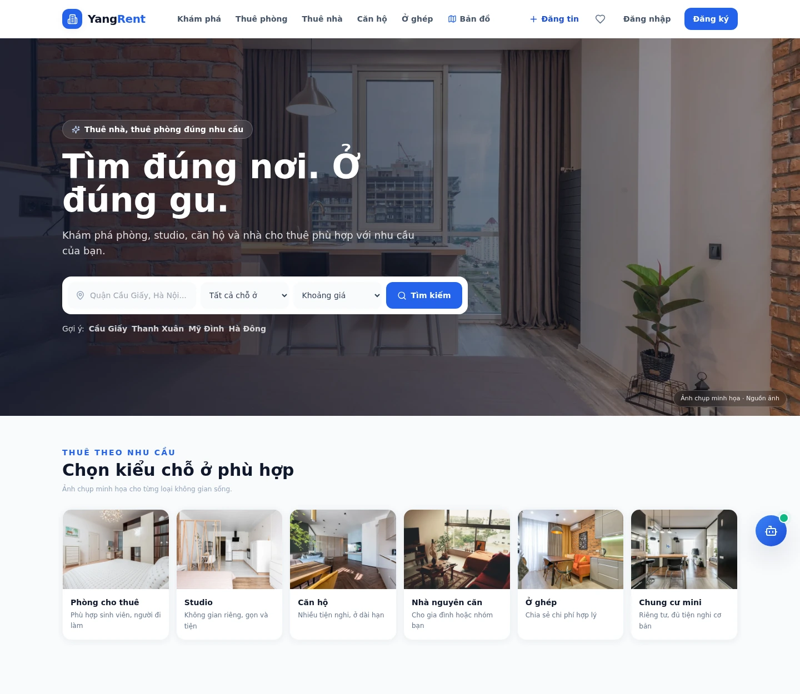
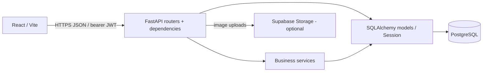

# YangRent

Website tìm phòng và quản lý cho thuê, với giao diện React/Vite và backend FastAPI,
SQLAlchemy. Có các vai trò quản trị viên, chủ trọ, người thuê và người dùng thông thường.



**Stack:** React 18 · JavaScript · Vite · FastAPI · SQLAlchemy · PostgreSQL (triển khai) / SQLite (demo local).

**[Mở Live Demo ↗](https://yangrent-portfolio-demo.onrender.com/)** · [CI](https://github.com/nguyenhonggiang2407/YangRent/actions/workflows/ci.yml) · [Kết quả triển khai](docs/hosting-status.md) · [Cấu hình demo riêng](docs/free-demo.md)

Demo mới chạy cả React và FastAPI trên một Render Free service, với 6 loại phòng mẫu có ảnh. Đã xác minh HTTPS, đăng ký/đăng nhập, hồ sơ, lọc phòng, lưu/bỏ yêu thích và kiểm tra quyền truy cập trên website thật ngày 04/11/2026. Bạn có thể đăng ký tài khoản bằng thông tin giả để thử; không có tài khoản quản trị công khai. Dữ liệu SQLite và khóa đăng nhập được tạo mới mỗi lần tiến trình khởi động. Dịch vụ miễn phí có thể cần chờ lúc mở lần đầu sau thời gian không hoạt động.

## Điểm bắt đầu khi review

- **Phân quyền và chủ sở hữu:** [dependency xác thực/role](backend/app/core/deps.py) và [API phòng/giữ chỗ](backend/app/routers/rooms.py).
- **Hai người giữ cùng một phòng:** [kiểm thử đồng thời](backend/tests/test_booking_concurrency.py) gửi hai yêu cầu qua hai kết nối SQLite độc lập. Một yêu cầu được tạo, yêu cầu còn lại nhận HTTP `409`.
- **Demo tách biệt:** [kiểm thử khởi tạo demo](backend/tests/test_portfolio_demo.py) xác nhận từ chối database đã cấu hình, chỉ tạo dữ liệu hư cấu và tạo lại khóa khi khởi động.
- **Bằng chứng kiểm tra:** [workflow CI](.github/workflows/ci.yml) chạy frontend, backend và smoke test Docker; [phạm vi kiểm chứng](docs/verification.md) phân biệt browser fixture với backend live.

## Chức năng

- Tìm phòng, lọc theo nhu cầu, lưu yêu thích và gửi yêu cầu đặt phòng.
- Đăng tin tìm người ở ghép, xem mức độ phù hợp theo khu vực và ngân sách.
- Nhắn tin và nhận thông báo.
- Chủ trọ quản lý hợp đồng, hóa đơn, chỉ số công tơ và yêu cầu bảo trì.
- Quản trị viên kiểm duyệt và quản lý dữ liệu.

Gợi ý phòng và ghép người dùng dựa trên quy tắc tính điểm.
Phần đọc công tơ và một số công cụ hỗ trợ đang ở dạng demo.

## Vai trò và nghiệp vụ

| Vai trò | Luồng chính trong source |
| --- | --- |
| Khách chưa đăng nhập | Tìm kiếm, lọc và xem chi tiết chỗ ở |
| `USER` | Lưu yêu thích, gửi yêu cầu giữ chỗ, nhắn tin và đăng nhu cầu ở ghép |
| `LANDLORD` | Đăng tin, xử lý yêu cầu cho phòng mình sở hữu, quản lý hợp đồng, hóa đơn và bảo trì |
| `TENANT` | Xem hợp đồng, hóa đơn liên quan; gửi yêu cầu và theo dõi dữ liệu của mình |
| `ADMIN` | Kiểm duyệt và quản trị qua các endpoint dành riêng cho quản trị viên |

Một tài khoản có thể có nhiều vai trò. Backend đọc JWT từ header `Authorization`,
kiểm tra tài khoản đang hoạt động, sau đó áp dụng role dependency và kiểm tra chủ sở hữu
ở từng endpoint. Việc ẩn nút trên frontend không thay thế kiểm tra quyền ở API.

Yêu cầu giữ chỗ bắt đầu ở `PENDING`; chủ phòng chấp nhận sẽ chuyển yêu cầu sang
`ACCEPTED` và phòng sang `RESERVED`. Hợp đồng, hóa đơn và bảo trì có các luồng riêng;
không mô tả chúng như một giao dịch đặt phòng tự động duy nhất.

## Kiến trúc và dữ liệu



Các router vừa có phần gọi service vừa có phần truy vấn ORM trực tiếp. Xem
[kiến trúc, mô hình dữ liệu và giới hạn](docs/architecture.md) để đối chiếu các bảng,
luồng hợp đồng/hóa đơn và vị trí kiểm tra quyền trong source.

## Chạy cục bộ

Cần Python 3.10 trở lên (cấu hình triển khai và CI dùng Python 3.12).
Node.js 24 là phiên bản CI hiện tại; cần npm để dùng lockfile đã lưu.

Trong thư mục `backend`, tạo và kích hoạt môi trường ảo. PowerShell:

```powershell
python -m venv .venv
.\.venv\Scripts\Activate.ps1
python -m pip install -r requirements-dev.txt
Copy-Item .env.example .env
```

Trên macOS/Linux:

```bash
python -m venv .venv
source .venv/bin/activate
python -m pip install -r requirements-dev.txt
cp .env.example .env
```

Điền `SECRET_KEY` và `JWT_SECRET` trong `.env` bằng hai chuỗi ngẫu nhiên riêng,
mỗi chuỗi ít nhất 32 ký tự. Có thể tạo tại máy bằng:

```bash
python -c "import secrets; print(secrets.token_urlsafe(48)); print(secrets.token_urlsafe(48))"
```

Để thử nhanh với SQLite, tạo database mẫu:

```bash
python -m seed.seed --local-demo
```

Lệnh tạo một tệp `yangrent-demo.db` mới với ba tài khoản và ba tin đăng hư cấu.
Mật khẩu được tạo khi chạy lệnh. Lệnh sẽ dừng nếu tệp đã tồn tại.

Đặt `DATABASE_URL=sqlite:///./yangrent-demo.db` trong `.env` rồi khởi động API:

```bash
python -m uvicorn app.main:app --host 127.0.0.1 --port 8000
```

Ở terminal khác, mở thư mục `frontend`:

```bash
npm ci
npm run dev
```

Vite chuyển `/api` đến `127.0.0.1:8000`. Nếu PowerShell không cho chạy script
kích hoạt, dùng `.\.venv\Scripts\python.exe` thay cho `python` trong các lệnh backend;
không cần thay chính sách máy để chạy dự án.

## Database và tài khoản quản trị

Cấu hình demo riêng hỗ trợ một [tài khoản xem thử trên máy cục bộ](docs/free-demo.md#optional-shared-login-for-a-local-walkthrough).
Tài khoản được cấp quyền `USER` và có sẵn một phòng hư cấu trong danh sách yêu thích.
Điền email và mật khẩu qua biến môi trường của tiến trình demo.

Database dùng khi triển khai là PostgreSQL. Alembic migration hiện có dùng cú pháp riêng
của PostgreSQL; không chạy chúng trên database SQLite mẫu.

Để tạo quản trị viên trên database đã cấu hình và migrate, chạy từ `backend`:

```bash
python provision_admin.py --create-admin
```

Lệnh hỏi thông tin và mật khẩu, đồng thời từ chối email đã tồn tại.

## Kiểm tra

Frontend:

```bash
npm test
npm run build
```

Backend:

```bash
python -m unittest discover -s tests -v
```

Các bài kiểm thử kiểm tra quyền truy cập, dữ liệu demo, cấu hình xác thực và thông báo.
Những tích hợp như bản đồ và tải ảnh cần kiểm tra thêm trên môi trường đã cấu hình dịch vụ.
Xem [kết quả kiểm tra](docs/verification.md) để phân biệt unit test,
browser fixture và truy cập dịch vụ public.

## Ảnh chụp

Banner và sáu nhóm chỗ ở dùng ảnh chụp khôi phục từ bộ ảnh cũ của YangRent, với bản WebP cho điện thoại và máy tính. Trang `/photo-credits` ghi tác giả và bản ảnh đã lưu. Ảnh chỉ minh họa loại không gian; tin đăng dùng ảnh của người đăng. Xem [nguồn ảnh và phạm vi sử dụng](docs/photo-sources.md).

Ảnh desktop ở đầu README và ảnh mobile dưới đây được chụp từ bản build đã qua
[CI và kiểm tra trình duyệt](https://github.com/nguyenhonggiang2407/YangRent/actions/runs/41661305056),
dùng API fixture hư cấu để kiểm tra giao diện; chúng không chứng minh dữ liệu hoặc
backend của bản triển khai đang hoạt động.

<details><summary>Xem giao diện điện thoại</summary>


</details>

Kiểm tra giao diện sau khi build:

```bash
npx playwright install chromium
npm run test:browser
```

## Cấu trúc

- `frontend/src/`: màn hình, thành phần giao diện và client API.
- `backend/app/routers/`: các route FastAPI.
- `backend/app/services/`: xử lý nghiệp vụ.
- `backend/app/models/` và `schemas/`: dữ liệu ORM và validation.
- `backend/migrations/`: Alembic migration.
- `backend/tests/` và `frontend/tests/`: kiểm thử.

Xem [hướng dẫn triển khai](docs/deployment.md) để cấu hình CORS, TLS,
PostgreSQL và lưu ảnh.

## Giới hạn hiện tại

- Thanh toán hóa đơn là mô phỏng: service tạo bản ghi `MOCK-*` và đánh dấu đã thanh toán, chưa kết nối cổng thanh toán.
- Gợi ý phòng/ở ghép dựa trên quy tắc; không phải mô hình máy học đã được huấn luyện.
- API `/api/health` của source hiện tại chỉ báo tiến trình đang phản hồi, không truy vấn database.
- Các trường tiền trong hóa đơn/thanh toán còn dùng số thực; cần đánh giá precision trước khi xử lý giao dịch thật.
- Khóa khi tạo yêu cầu giữ chỗ áp dụng cho luồng API này. Cần xem lại riêng các yêu cầu trùng đã tồn tại từ trước và các đường ghi trực tiếp vào database.
- Browser test dùng API fixture; cần kiểm thử tích hợp với PostgreSQL và xác minh đăng nhập, persistence, uploads trên host trước khi coi là bản production.

## Nguồn và quyền sử dụng

Kho mã không kèm database, cấu hình riêng hoặc ảnh tải lên của người dùng.
Dự án gốc chưa có giấy phép tái sử dụng chung; xem [thông tin nguồn](docs/source-notice.md).
